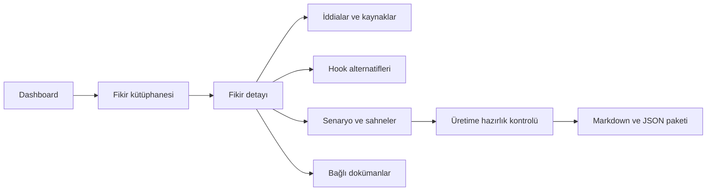

# Ideation — Ürün ve Uygulama Planı

**Tarih:** 31 Ekim 2026  
**Proje dizini:** `video-tools2/ideation/`  
**Planın durumu:** İlk yerel sürüm geliştirildi. Gerçekleştirilen kapsam ve sınırlar [uygulama notlarında](IMPLEMENTATION.md) açıklanmıştır. Aşağıdaki maddeler ilk ürün tasarımını ve geliştirme sırasını korur.

## 1. Amaç

Dağınık fikir listelerini, kaynak bağlantılarını, araştırma notlarını ve senaryo denemelerini tek çalışma alanında toplamak. Kullanıcı bir fikri açtığında neden ilginç olduğunu, hangi iddialarının desteklendiğini, hangi anlatımın seçildiğini ve üretime geçmek için neyin eksik kaldığını görebilmeli.

Ana soru: **Sıradaki videoyu hangisinden yapmalıyız ve o fikri hazırlamak için ne eksik?**

İlk sürüm yerel bilgisayarda tek kullanıcı için çalışacak. Bunun için bulut hesabı veya harici hizmet gerekmeyecek. Mevcut `animator` uygulamasından ayrı kurulacak ve kendi bağımlılıklarına sahip olacak.

## 2. Kesinleşmiş tercih ve varsayımlar

| Başlık | Karar |
| --- | --- |
| İçerik kapsamı | Gündelik nesneler, bilim, davranış, tasarım, altyapı ve tarihî olaylar |
| Marka kullanımı | Şirket veya belirli markalı ürün merkezli hikâyeler kapsam dışı |
| Video süresi | 20–60 saniye; hikâyenin ihtiyacına göre |
| Arayüz dili | Türkçe |
| İçerik dili | Türkçe araştırma; Türkçe veya İngilizce hook ve senaryo |
| Kullanıcı | İlk sürümde tek kişi |
| Çalışma biçimi | Yerel tarayıcı arayüzü ve yerel sunucu |
| Yayınlama | İlk sürümün işi fikir ve içerik hazırlamak; internete açık dağıtım planlanmıyor |
| Kalıcılık | Sunucu tarafında SQLite ve dosya deposu; tarayıcı kapanınca içerik kaybolmaz |
| Otomasyon | İlk sürüm manuel araştırma ve düzenleme; ücretli yapay zekâ çağrısı gerekmiyor |

Tarihî yerlerin, bilim insanlarının ve kaynak kurumlarının adları şirket hikâyesi sayılmayacak. Marka merkezli bir olayı yalnızca adını gizleyerek anlatmak kapsam tercihine uygun kabul edilmeyecek.

## 3. Başlangıç içeriği

İki Markdown araştırma dokümanından 20 fikir içe aktarılacak:

- `animator/videos/video-fikirleri-arastirma-ve-degerlendirme.md`
- `animator/videos/video-fikirleri-arastirma-ve-degerlendirme-02.md`

| Kapsam durumu | Sayı | Davranış |
| --- | --- | --- |
| Uygun | 14 | Aktif fikir listesinde görünür |
| Yeniden yazım gerekli | 1 | Koşullu listede görünür; üretime hazır sayılmaz |
| Kapsam dışı | 5 | Saklanır; varsayılan aktif listeden çıkarılır |

Başlangıçta 20 fikir de üretim açısından **Fikir havuzu** aşamasında olacak. Önceki dokümanlarda “ilk üretim grubu” önerisi bulunması, fikrin tamamlanmış senaryosu veya doğrulanmış iddiaları olduğu anlamına gelmeyecek.

Kaynak bağlantıları, hook'lar, süre önerileri, sahne akışları ve uyarı notları kendi alanlarına taşınacak. Araştırma dokümanlarının orijinalleri doküman kütüphanesine alınacak; her fikir kendi kaynak bölümüne referans verecek.

İlk import, mevcut Markdown dosyalarını değiştirmeyecek. Başlangıç envanteri `seed/import-manifest.json` içinde tutulur. Bu dosya, içeriğin tamamının içe aktarıldığı anlamına gelmez.

Mevcut üretilmiş burç dışı videolar için ikinci aşamada ayrı bir import yapılabilir. Senaryo, rapor, ses ve video yolları fikirle ilişkilendirilir; render dosyaları veritabanına kopyalanmaz. Burç serileri varsayılan import kapsamına alınmaz.

## 4. Uygulamanın ana bölümleri

### 4.1 Dashboard

Ana ekran karar vermeye yardım edecek:

- Aktif fikir, araştırılan fikir, taslak senaryo ve üretime hazır fikir sayıları.
- Elle belirlenen öncelik sırasına göre sıradaki adaylar.
- “Kaynak var ama iddia eşlemesi eksik”, “hook seçilmedi”, “süre aşılmış”, “kapsamı yeniden değerlendir” gibi somut eksikler.
- Son düzenlenen fikirler ve dokümanlar.
- Kategorilere ve hedef sürelere göre dağılım.
- Hızlı fikir ekleme ve global arama.

Uygulamada gerçek izlenme verisi bulunmadığı sürece sahte performans, tahmini viral olma yüzdesi veya örnek gelir grafikleri gösterilmeyecek. Boş metrikler gerçek boş durum olarak sunulacak.

### 4.2 Fikir kütüphanesi

Kart ve tablo görünümleri olacak. Her kayıtta başlık, kısa açıklama, seçili hook, kategori, süre, aşama, kapsam, öncelik ve son güncelleme görünür.

Filtreler: kategori, etiket, 20–30 / 30–45 / 45–60 saniye aralığı, aşama, kapsam, favori, kaynak/iddia eksiği. Filtre birleşimleri URL'de tutulur; geri tuşu ve paylaşılabilir yerel bağlantılar çalışır.

Süre filtresi, kaydın alt ve üst süre aralığının filtreyle kesişmesine göre çalışır. Örneğin 25–40 saniyelik fikir, ilgili iki süre grubunda da bulunabilir.

Toplu işlemler: etiket ekleme, arşivleme, öncelik değiştirme ve seçilenleri dışa aktarma. İlk sürümde kalıcı silme yerine geri alınabilir çöp kutusu kullanılacak.

### 4.3 Fikir detay sayfası

Üst alanda başlık, durum, kapsam nedeni, süre ve öncelik; alt alanda sekmeler:

| Sekme | İçerik |
| --- | --- |
| Genel bakış | Ana soru, şaşırtıcı cevap, mekanizma, hedef izleyici bağı, neden ilginç olduğu |
| Araştırma | Markdown notları, kaynaklar, iddialar, çelişkiler, açık sorular |
| Hook'lar | Birden fazla açılış, dil, ilk görüntü, neden çalışabileceği, seçili sürüm |
| Senaryo | Sürümler, dil, metin, kelime sayısı ve tahmini süre |
| Sahne akışı | Süre, anlatım, görüntü, mekân, karakter ve ses notları |
| Dosyalar | İlgili Markdown, PDF ve görseller |
| Geçmiş | Kaydetmeler, sürüm değişiklikleri ve durum geçişleri |

Dokümanlar otomatik kaydedilir; “kaydediliyor / kaydedildi / hata” durumu görünür. Kaydedilmemiş metin, bağlantı hatasında ekrandan silinmez. Aynı kaydın iki sekmede düzenlenmesinde sürüm kontrolü sessizce veri ezilmesini önler.

### 4.4 Araştırma ve kaynak kütüphanesi

Aynı kaynak birden fazla fikre bağlanabilir. Kaynak kaydı: URL, başlık, kurum/yazar, yayın tarihi, erişim tarihi, kaynak türü, kısa not ve bağlantılı fikirler.

Kaynak türleri: özgün araştırma, resmî kurum, birinci elden anlatı, ikincil haber, diğer. Bu tür tek başına güvenilirlik puanı sayılmaz.

İddia kaydı, hangi cümleyi desteklediğini açıkça taşır. İlişki türleri: **destekliyor, kısmen destekliyor, çelişiyor, yalnızca arka plan**. Bir kaynak eklemek bütün fikri “doğrulandı” yapmaz.

İlk sürümde URL'ler otomatik taranmaz. Kaynağın tekrar okunması ve doğrulanması kullanıcı işaretlemesidir. Yalnızca URL biçimi veya içe aktarılan bağlantının bulunması, sayfanın erişilebilir veya doğru olduğunu göstermeyecek.

### 4.5 Doküman kütüphanesi

Fikir dokümanlarıyla kanal geneli dokümanlar aynı yerde bulunabilir. Türler: araştırma, senaryo, değerlendirme, görsel brief, yayın metni ve genel not.

Markdown düzenleyici ve önizleme; PDF/görsel yükleme ve önizleme; etiket ve fikir bağlantısı olacak. Yüklenen PDF, görsel veya diğer orijinal dosyalar ilk sürümde metin içeriklerine göre aranmış gibi gösterilmeyecek. Başlıkları ve notları aranabilir; OCR sonraki aşamadır.

Mevcut iki uzun dokümanın orijinalleri korunur. Ayrıştırılan fikir bölümleri düzenlenebilir kayıtlardır; orijinal dokümanların yeni bir araya getirilmiş kopyası değildir.

### 4.6 Kanban

Üretim akışı:

**Fikir havuzu → Araştırılıyor → Senaryo yazılıyor → Üretime hazır → Üretimde → Yayımlandı**

Kapsam ayrı bir eksendir: **Uygun / Yeniden yazım gerekli / Kapsam dışı**. Arşiv durumu da ayrı tutulur. Böylece “araştırılmış ama kapsam dışı” bir kayıt bilgi kaybetmeden temsil edilir.

Sürükle-bırak yanında klavye ve açılır menüyle durum değiştirme bulunur. Uygun kapsamda olmayan fikir üretime hazır veya üretimde aşamasına geçirilemez; gerekçe gösterilir. Bunun için ayrıca kullanıcıya sürekli onay pencereleri açılmaz.

### 4.7 Ayarlar ve taşınabilirlik

Kategoriler, etiketler, yayın dili, senaryo süre hesabında kullanılacak konuşma hızı ve yedekleme tercihleri düzenlenebilir.

- Tek fikri Markdown olarak dışa aktarma.
- Seçilen fikirleri JSON ve Markdown olarak dışa aktarma.
- Veritabanı ve ek dosyalarla tam yedek oluşturma ve geri yükleme.
- İçe aktarma önizlemesi, hata raporu ve işlem özeti.

## 5. Eklenmesini önerdiğim özellikler

### İddia–kaynak eşlemesi

Kaynak listesi ayrı, senaryodaki gerçek iddialar ayrı tutulmalı. Örneğin “altı dakika” sayısı kullanılıyorsa, bunu destekleyen kaynak ve ilgili kapsam bilgisi görülebilmeli. İddiaların durumları: incelenmedi, desteklendi, kısmen desteklendi, tartışmalı, destek bulunamadı.

İlk importtaki kaynaklar bilinen bağlantılar olarak gelir; iddia düzeyinde inceleme yapılmadan otomatik doğrulama etiketi verilmez. Kanıt kartı, sonraki senaryolarda aynı hatalı genellemeyi tekrarlamayı önler.

### Hook ile ilk görüntüyü eşleme

Her hook için “ilk 2–3 saniyede ne görüyoruz?” alanı olmalı. Yazılı olarak ilginç görünen ama görüntüsü olmayan fikirler erken fark edilir. Hook alternatifleri birbirini silmeden saklanır.

### Görsel uygulanabilirlik

Her fikir için gerekli mekân, karakter, ana nesne, karmaşık efekt, eldeki sahnelerin yeniden kullanımı ve hazırlık zorluğu kaydedilmeli. Maliyet puanı yerine düşük/orta/yüksek ve kısa gerekçe yeterli.

### Süreyi iki ayrı biçimde izleme

Kelime sayısı ve ayarlanabilir konuşma hızından hesaplanan süre **tahmin** olarak etiketlenir. Sahne süreleri toplamı ayrıca gösterilir. Ses dosyası oluşturulduğunda ölçülen süre ayrı alanda tutulur; tahmin gerçek ses süresi gibi sunulmaz.

### Karar gerekçesi

Bir fikir ertelendiğinde veya kapsam dışı bırakıldığında kısa gerekçe saklanmalı. Beğenilmeyen fikirlerin silinmesi yerine öğrenilenler korunmalı. Marka tercihi değişmedikçe aynı marka hikâyesi tekrar önerilmemeli.

### Üretime aktarım paketi

Seçili hook, senaryo, sahne planı, iddialar, kaynaklar ve anlatım sınırları tek paket olarak dışa aktarılır. İlk sürümde Markdown ve JSON yeterli. Remotion üretim dosyalarına otomatik yazma ve render başlatma sonraki aşamada ele alınır.

## 6. Arayüz ve tasarım

Görsel yön: düzenli bir editoryal çalışma masası. Koyu lacivert/grafit navigasyon, açık ve sıcak nötr içerik alanı, tek vurgu rengi; durum renkleri yalnızca anlam taşıyan etiketlerde kullanılır. Karışık bir grafik ekranı yerine okunabilir başlıklar, kısa özetler ve rahat belge okuma alanı önceliklidir.

Sol navigasyon: **Dashboard, Fikirler, Araştırma, Dokümanlar, Üretim panosu, Arşiv, Ayarlar**.

Üst çubuk: global arama, hızlı fikir ekleme, içe aktarma. Dashboard'da dar bir özet satırının altında sıradaki adaylar ve eksikler; alt bölümde son dokümanlar bulunur.

Fikir detayında geniş düzenleme alanı ve dar bir bilgi sütunu kullanılır. Kaynak açmak veya hook düzenlemek için mümkün olduğunca fikirden ayrılmak gerekmez. Dar ekranda yan panel alt bölüme dönüşür.

Erişilebilirlik: klavye gezintisi, görünür odak, okunabilir kontrast, etiketli formlar, yalnızca renkle verilmeyen durumlar, azaltılmış hareket tercihi. Masaüstü öncelikli ama tablet ve telefonda okunabilir/düzenlenebilir tasarım.



## 7. Teknik mimari

### Önerilen teknoloji

| Katman | Tercih | Gerekçe |
| --- | --- | --- |
| Arayüz | React + TypeScript + Vite | Mevcut projedeki React bilgisiyle uyumlu, ayrı ve hızlı bir uygulama |
| Sayfa yönlendirme | React Router | Fikir ve dokümanlar için kalıcı yerel URL'ler |
| Sunucu verisi | TanStack Query | Kaydetme, yenileme ve hata durumlarını tutarlı yönetme |
| Yerel API | Node.js + Fastify + TypeScript | Dosya erişimi, kalıcı kayıt ve import işlemleri |
| Kalıcı kayıt | SQLite, `better-sqlite3` adaptörü üzerinden | Tek kullanıcı ve yerel veri için uygun; ayrı veritabanı hizmeti gerekmez |
| Doğrulama | Zod şemaları | API, import ve export verilerinin ortak kuralları |
| Arama | SQLite FTS5 | Fikir, not, iddia ve metin dokümanlarında tam metin arama |
| Markdown | CodeMirror düzenleme + güvenli Markdown önizleme | Açık metin içeriğini korurken rahat düzenleme |
| Arayüz bileşenleri | Erişilebilir bileşenler, sade CSS değişkenleri ve Lucide ikonları | Tutarlı görsel sistem ve klavye desteği |
| Kontroller | Vitest ve gerçek tarayıcı akışları | Veri kaybı, import ve temel kullanım akışlarını doğrulama |

Kurulumda kullanılacak sürümler birlikte seçilip kilit dosyasına yazılacak. Mevcut makinede Node v24.7.0 ve npm 11.6.0 var. Yerleşik SQLite ve FTS5 bellek içi veritabanında kontrol edildi; bu Node sürümü yerleşik SQLite için deneysel özellik uyarısı verdiğinden plan veritabanı erişimini ayrı bir adaptör arkasında tutuyor.

### Veri sahipliği

**Uygulamadaki yapılandırılmış içerik ve düzenlenebilir dokümanlar için tek doğruluk kaynağı SQLite olacak.** Markdown dosyalarına aynı anda çift yönlü yazma yapılmayacak.

Yüklenen orijinal dosyalar `.data/uploads/` altında, içerik özetiyle adlandırılarak saklanır. Veritabanı bu dosyaların kimlik ve yollarını tutar. Markdown/JSON dışa aktarımlar uygulamadan alınan anlık kopyalardır; düzenlenip tekrar import edilmedikçe uygulamayı değiştirmez.

Mevcut araştırma dosyaları import kaynağı olarak kalır. Sonradan kaynak dosya değişirse fark raporu gösterilir; uygulamadaki düzenlemelerin üstüne sessizce yazılmaz.

### Çalıştırma hedefi

Geliştirmede tek komut arayüzü ve API'yi başlatır. Paketlenmiş kullanımda API, derlenmiş arayüzü de sunar. Sunucu varsayılan olarak yalnızca `127.0.0.1` üzerinde dinler. İlk sürümde hesap sistemi bulunmaz; bu varsayım yerel kullanım içindir. İnternete açılması gerekirse kimlik doğrulama ayrı gereksinim olur.

## 8. Veri modeli

| Varlık | Temel alanlar |
| --- | --- |
| Idea | id, başlık, slug, özet, ana soru, mekanizma, kategori, dil, süre alt/üst sınırı, aşama, kapsam, kapsam gerekçesi, öncelik, favori, arşiv/çöp kutusu tarihi, sürüm |
| Hook | ideaId, metin, dil, ilk görüntü, not, seçili durumu |
| Document | id, tür, başlık, Markdown içerik, dil, güncel sürüm, orijinal kaynak referansı |
| DocumentRevision | documentId, sürüm, içerik, değişiklik notu, tarih |
| IdeaDocument | ideaId, documentId; bir doküman birden fazla fikre bağlanabilir |
| Source | id, URL, normalize edilmiş URL, başlık, kurum/yazar, yayın/erişim tarihi, tür, not |
| IdeaSource | ideaId, sourceId, ilgili bölüm/not |
| Claim | ideaId, iddia metni, inceleme durumu, kapsam sınırlaması |
| ClaimSource | claimId, sourceId, destek/çelişki türü, kanıt notu |
| Scene | ideaId, sıra, süre, anlatım, görüntü, mekân, karakter, ses notu |
| Evaluation | ideaId, hook/hikâye/görsel puanı, hazırlık zorluğu, gerekçe |
| Attachment | dosya kimliği, orijinal ad, MIME, boyut, hash, bağlandığı kayıt |
| ImportRun | kaynak kimliği, hash, sonuç, çatışmalar, tarih |
| Activity | kayıt, işlem, önceki/yeni durum, tarih |
| Settings | kategori ve etiketler, konuşma hızı, yedek tercihleri |

Eksik alanlar boş kalabilir. Puanlar tahminî sayıyla doldurulmaz; ikinci dokümanda bulunmayan sayısal puanlar bilinmiyor olarak gelir. Puanlar otomatik viral olma puanına çevrilmez.

20–60 saniye kuralı kayıtta doğrulanır: alt sınır üst sınırdan büyük olamaz. Kaynak ve dokümanlar ilişkisel bağlarla saklanır; aynı URL veya dosya için gereksiz kopyalar oluşturulmaz.

## 9. Import ve dışa aktarma davranışı

1. Envanter, 1–20 numaralı fikirleri ve kaynak doküman başlıklarını tanımlar.
2. Markdown başlıkları ayrıştırılır; karşılaştırma tabloları ve genel notlar ayrı değerlendirilir.
3. Önizleme, bulunabilen alanları, eksikleri ve kapsam durumunu gösterir.
4. Kaynak URL'leri normalize edilir; anlamlı sorgu parametreleri silinmez.
5. İlk import bir işlem içinde oluşturulur. Fikrin kaynak kimliği, bölüm numarası ve hash bilgisi kaydedilir.
6. Aynı içerik tekrar import edildiğinde fikir sayısı artmaz.
7. Kaynak değişmişse güncellenen alanlar için fark gösterilir; yerel değişiklikler korunur.
8. Ayrıştırılamayan alan ham bölüm metni olarak saklanır; sessizce atılmaz.

Eski dokümanlardaki kapsam dışı fikirler ve elenen hikâyeler birbirine karıştırılmamalı. İkinci dokümanın sonunda anlatılan Strowger ve düz paket anekdotları, yeni fikir 21–22 olarak import edilmez; genel araştırma notu olarak korunur.

## 10. Arama ve filtreleme

Arama başlık, özet, hook, düzenlenebilir Markdown dokümanları, iddia ve kaynak notlarını kapsar. Sonuçlarda eşleşmenin türü ve ilgili fikir gösterilir.

Türkçe büyük/küçük harf ve aksan aramaları için normalize edilmiş indeks alanı kullanılır. Örnek kabul senaryoları: `İsviçre/isviçre`, `IŞIK/ışık`, `köprü/kopru`. Orijinal metin değiştirilmez. FTS5'in tek başına Türkçeye özgü bütün dönüşümleri çözdüğü varsayılmaz.

Arşiv ve kapsam dışı kayıtlar varsayılan sonuçlardan ayrılır; “tüm kayıtlarda ara” seçeneği bulunur. Doğrudan bağlantıyla açılan kapsam dışı fikirde durum ve neden görünür kalır.

## 11. Kalıcılık, dosyalar ve kurtarma

- API istekleri şemayla doğrulanır; uzun metin ve dosya boyut limitleri tanımlanır.
- SQL sorguları parametreli çalışır.
- Markdown'daki ham HTML çalıştırılmaz; tehlikeli URL şemaları engellenir.
- Yüklenen dosya adları dosya sistemi yolu olarak doğrudan kullanılmaz.
- Dosya yükleme önce geçici alana yapılır, doğrulandıktan sonra kalıcı alana taşınır.
- Doküman kaydında beklenen sürüm numarası gönderilir; çatışma olursa kullanıcıya fark ve yeniden yükleme seçeneği sunulur.
- Başarısız otomatik kayıt görünür olur; taslak metin ekranda kalır ve yeniden deneme yapılabilir.
- Şema geçişleri numaralı migration dosyalarıyla uygulanır.
- İlk import ve şema geçişleri öncesinde yedek alınır.
- Canlı veritabanı sıradan dosya kopyasıyla yedeklenmez; SQLite'ın tutarlı yedekleme yöntemi kullanılır.
- Tam yedek, veritabanıyla birlikte dosya deposunu ve bir manifesti içerir. Geri yükleme önce geçici dizinde doğrulanır; mevcut veri hemen ezilmez.

## 12. Önerilen klasör yapısı

```text
ideation/
  README.md
  package.json
  package-lock.json
  .gitignore
  docs/
    PLAN.md
  seed/
    import-manifest.json
  src/
    app/                 # Sayfalar, yönlendirme ve ortak düzen
    features/
      dashboard/
      ideas/
      research/
      documents/
      pipeline/
      settings/
    components/
    styles/
  server/
    api/
    db/
      migrations/
    services/
      import/
      export/
      backup/
    storage/
  shared/
    schemas/
    types/
  scripts/
  tests/
  .data/                 # Yerel veri; Git dışında
    ideation.sqlite
    uploads/
  .backups/              # Git dışında
```

Bu ağaç ilk tasarımın hedef yapısını gösterir. Gerçekleştirilen sürüm ve veri yerleşimi README ile uygulama notlarında açıklanmıştır.

## 13. Geliştirme sırası ve her adımın çıktısı

| Aşama | İş | Tamamlanma ölçütü |
| --- | --- | --- |
| 1 | Uygulama temeli, veri modeli, migration, import | 20 fikir kalıcı kayıttan yüklenir; 14 uygun / 1 yeniden yazım / 5 kapsam dışı sayıları doğru |
| 2 | Tasarım sistemi, dashboard, fikir kütüphanesi ve detay | Gerçek içerik görünür; filtre, arama, yeni fikir ve düzenleme çalışır |
| 3 | Araştırma, iddia eşlemesi ve doküman düzenleme | Fikir–kaynak–iddia ilişkileri ve Markdown sürümleri kaydedilip yeniden açılabilir |
| 4 | Hook alternatifleri, senaryo, sahne akışı ve Kanban | Fikirden üretime hazırlık akışı tamamlanır; süreler tahmin/ölçüm olarak ayrılır |
| 5 | Export, yedek/geri yükleme, dosyalar ve son doğrulama | Seçili fikir paketi indirilebilir; yedek yeni veri dizininde geri yüklenebilir |

İlk kullanılabilir sürüm 1–3 aşamalarında ortaya çıkar. İlk tam sürümün tamamlanması 4–5 aşamalarındaki temel üretim ve veri taşıma akışlarını da kapsar.

## 14. Kontrol ve kabul senaryoları

1. İki doküman import edildiğinde tam 20 fikir gelir. Aynı import tekrarlandığında sayı değişmez.
2. Kapsam dışı beş fikir varsayılan aktif listede görünmez; arşiv/filtre üzerinden okunabilir.
3. Sarı nokta fikri yeniden yazım gerektiren tek kayıt olarak gelir.
4. Kaynak eklenmesi iddiayı otomatik doğrulamaz. Destekleyen ve çelişen kaynaklar ayrı gösterilir.
5. Yeni fikir ve doküman kaydedilir; tarayıcı ve sunucu yeniden açıldığında içerik korunur.
6. İki sekmede aynı doküman değiştirildiğinde birinin metni sessizce kaybolmaz.
7. API hatasında kaydedilmemiş metin korunur ve hata görünürdür.
8. Türkçe arama ve birleşik filtreler beklenen kayıtları getirir.
9. Senaryo tahmini süreyle sahne toplamı ayrı hesaplanır; gerçek ses süresi yoksa uydurulmaz.
10. Kapsam dışı fikir üretime hazır/üretimde aşamasına geçirilemez.
11. Markdown export, seçili hook, kaynaklar, sınırlar ve sahneleri içerir.
12. Tam yedek farklı bir veri dizinine geri yüklendiğinde fikirler ve dosyalar yeniden açılır.
13. Klavye kullanımı, dar ekran, uzun başlıklar ve boş/hata durumları tarayıcıda kontrol edilir.

Değişikliklere uygun birim ve entegrasyon testleriyle başlanır. Sonrasında import → düzenleme → kaynak bağlama → durum değiştirme → export → yeniden başlatma akışı gerçek tarayıcıda doğrulanır. Test verisi ve çalışma verisi ayrı dizinlerde tutulur.

## 15. İlk sürüm sonrasında

İhtiyaç görüldüğünde: mevcut `animator/videos` projeleriyle bağlantı, yayın sonuçlarının manuel kaydı, fikir karşılaştırma ekranı, benzer konu uyarıları, PDF metin çıkarma, referans görsel panosu ve kontrollü yardımcı araştırma özellikleri.

Otomatik internet araştırması, izlenme tahmini, ekip içi işbirliği ve doğrudan video render başlatma ilk sürümün zorunlu parçası değildir. Bunlar çekirdek fikir ve doküman yönetimi tamamlandıktan sonra değerlendirilecek.

## 16. Teknik başvuru kaynakları

- [Vite — başlangıç ve ortam gereksinimleri](https://vite.dev/guide/)
- [SQLite — FTS5 tam metin arama](https://www.sqlite.org/fts5.html)
- [SQLite — tutarlı canlı yedekleme](https://sqlite.org/backup.html)
- [SQLite — WAL davranışı ve eşzamanlı erişim](https://www.sqlite.org/wal.html)

Bu dokümandaki teknoloji seçimi ve ürün kapsamı proje için önerilen uygulama kararlarıdır. Kaynaklar, ilgili araçların yeteneklerini ve çalışma biçimlerini doğrulamak için kullanılmıştır.
